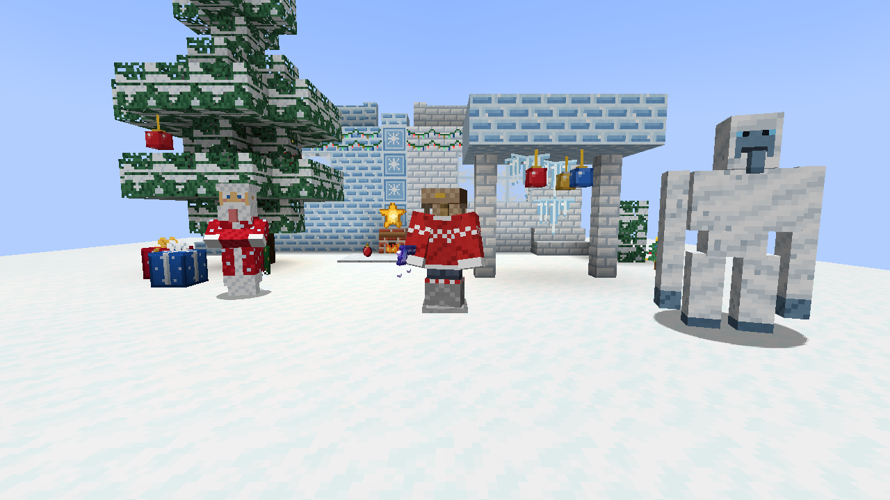
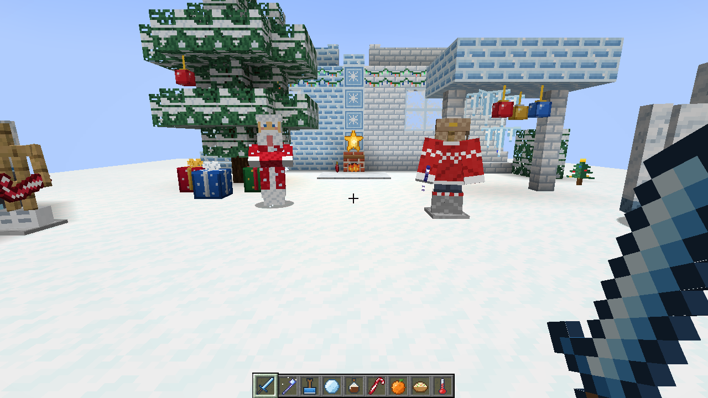
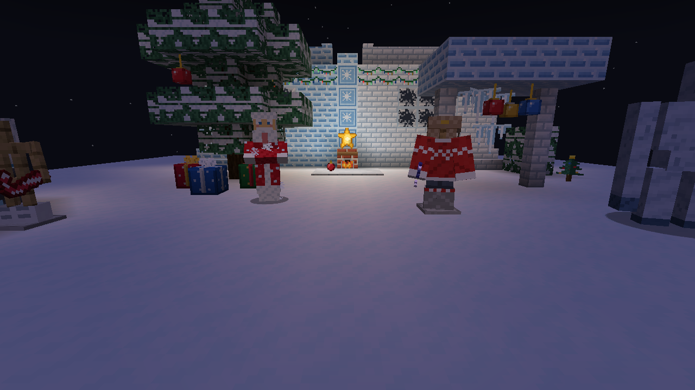
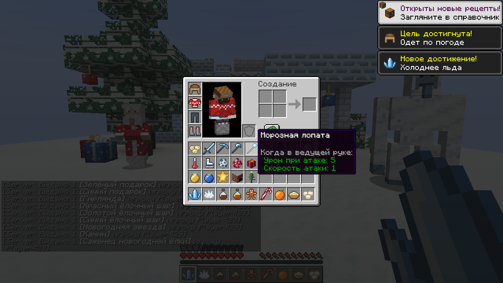
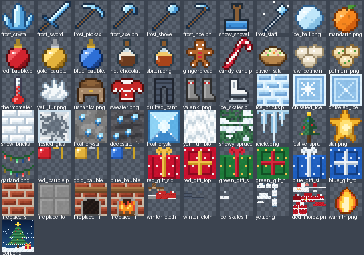

# ❄ Winter — зимний мод для Minecraft

Мод про настоящую зиму: в снежных биомах теперь холодно, а пережить мороз помогают тёплая одежда, горячие напитки и камин.
Ещё в моде есть Дед Мороз и йети, подарки под ёлкой, гирлянды, ёлочные игрушки, морозные кристаллы, коньки, пельмени и оливье.



| | |
|---|---|
| **Minecraft** | 1.21.1 |
| **Загрузчик** | Fabric Loader ≥ 0.16 |
| **Зависимости** | [Fabric API](https://modrinth.com/mod/fabric-api) |
| **Языки** | русский, английский |

| Днём | Ночью |
|---|---|
|  |  |

| Инвентарь и полный комплект зимней одежды | Все текстуры мода |
|---|---|
|  |  |

## Установка

1. Установите [Fabric Loader](https://fabricmc.net/use/installer/) для Minecraft 1.21.1.
2. Положите в папку `mods` файл `winter-1.0.0.jar` и Fabric API.
3. Запустите игру с профилем Fabric. Все предметы мода собраны во вкладке творческого режима **«Зима»**.

---

## Мороз и тепло

В холодных биомах игрок постепенно замерзает: по краям экрана появляется иней, он замедляется, а потом начинает получать урон.
Используется ванильная механика замерзания, как в рыхлом снегу. Холодными считаются биомы, где идёт снег, в том числе вершины гор.

**Холод усиливают:** ночь, метель (снегопад над головой), ледяная вода.
**Холод ослабляют:** крыша над головой (в укрытии мёрзнешь вдвое медленнее) и тёплая одежда.
**Согревают:** эффект «Тепло», а также костёр, камин, лава, магма, огонь и горящая печь в радиусе 3 блоков.

### Утепление

Каждая вещь даёт очки утепления. При 8 очках холод не страшен, при меньшем количестве вы замерзаете медленнее.

| Вещь | Очки |
|---|---|
| Ушанка, вязаный свитер, ватные штаны, валенки | 2 за каждую |
| Кожаная броня, коньки | 1 за каждую |
| Зачарование «Утепление» I/II | +1/+2 к предмету |

Узнать температуру и своё утепление можно **термометром** (ПКМ).

### Правила игры

| Правило | По умолчанию | Что делает |
|---|---|---|
| `/gamerule winterFreezing` | `true` | включает замерзание в холодных биомах |
| `/gamerule winterFreezingDamage` | `true` | наносит ли полное замерзание урон |

---

## Предметы

### Одежда
| Предмет | Рецепт |
|---|---|
| **Шапка-ушанка** | 2 кожи и 3 меха, форма шлема; мех — кроличья шкурка или мех йети |
| **Вязаный свитер** | 7 шерсти, форма нагрудника |
| **Ватные штаны** | 6 шерсти и 1 кожа, форма поножей |
| **Валенки** | 4 шерсти, форма ботинок |
| **Коньки** | 4 кожи и 2 железных слитка. На льду ускоряют на 60% |

Ушанка, свитер, штаны и валенки к тому же защищают от рыхлого снега, как кожаная броня.

### Еда и напитки
| Предмет | Как получить | Эффект |
|---|---|---|
| **Горячий шоколад** | ведро молока, 2 какао-бобов, сахар и 3 бутылочки → 3 шт. | «Тепло» на 3 минуты |
| **Сбитень** | бутылочка мёда, 2 сладкие ягоды, сахар | «Тепло» на 2 минуты, регенерация |
| **Имбирный пряник** | 2 пшеницы, сахар, соты → 6 шт. | быстро съедается |
| **Леденцовая тросточка** | 2 сахара и красный краситель → 3 шт. | ускорение |
| **Мандарин** | подарки, Дед Мороз, сундуки, заснеженная хвоя | — |
| **Салат оливье** | миска, печёный картофель, морковь, яйцо, жареная курица | сытный, даёт поглощение |
| **Сырые пельмени** | 2 пшеницы, яйцо, говядина или свинина → 4 шт. | — |
| **Пельмени** | сырые пельмени в печи, коптильне или на костре | «Тепло» на 30 секунд |

### Инструменты и оружие
| Предмет | Описание |
|---|---|
| **Морозные инструменты** (меч, кирка, топор, лопата, мотыга) | из морозных кристаллов. По силе между железом и алмазом. Меч замораживает и замедляет врагов |
| **Посох Деда Мороза** | стреляет ледяными зарядами: урон 7, сильная заморозка, превращает воду в лёд. Продаёт Дед Мороз, можно скрафтить из блока морозного кристалла, алмаза и огненного стержня |
| **Снеговая лопата** | убирает снег сразу площадью 3×3. Присядьте, чтобы копать по одному блоку |
| **Ледышка** | 4 снежка и лёд → 4 шт. Бьёт на 3 урона и замораживает, стреляет из раздатчика |
| **Термометр** | стекло, красная пыль, стекло (вертикально) |

### Зачарования
* **Утепление** (I–II) — для брони, +1 очко утепления за уровень.
* **Ледяное касание** (I–II) — для мечей и булавы: замораживает и замедляет цель. Несовместимо с заговором огня.

---

## Блоки

* **Ледяные и снежные кирпичи** со ступеньками, плитами и стенами, а также **резные ледяные кирпичи**. Делаются из плотного льда и снежных блоков, есть рецепты для камнереза. Ледяные кирпичи скользкие.
* **Морозное стекло**: 8 стекла и снежок.
* **Руда морозного кристалла** (обычная и глубинносланцевая) и **блок морозного кристалла**.
* **Сосульки** свисают с потолка, тают от яркого света и колются.
* **Заснеженная хвоя** и **саженец новогодней ёлки**: из саженца вырастает ёлка, сразу наряженная шарами.
* **Гирлянда** — мигающие огоньки на стене.
* **Ёлочные шары** (красный, золотой, синий) вешаются под листву или блок.
* **Новогодняя звезда** — для макушки ёлки, ярко светится.
* **Подарки** (красный, зелёный, синий). Нажмите ПКМ, чтобы развернуть и получить случайные гостинцы. Если сломать, подарок можно унести и подарить другу. Рецепт: бумага, нитки, краситель и изумруд.
* **Камин** разжигается огнивом или огненным шаром, тушится лопатой. Светит, потрескивает, дымит трубой и согревает.
* **Блок и ковёр из меха йети** гасят вибрации, как шерсть.

## Существа

* **Йети** — огромный зверь снежных гор и равнин, появляется ночью. 60 здоровья, бьёт так, что подбрасывает в воздух и замораживает. Из него выпадают мех йети, снежки и иногда морозный кристалл.
* **Дед Мороз** — редкий торговец, бродит по снежным биомам. Продаёт угощения, украшения, подарки, саженцы ёлок, коньки, книги зачарований и свой посох. Через пару игровых дней уходит. Обижать его не стоит: из него выпадает только уголь.

## Мир

В снежных биомах появляются:
* руда морозного кристалла (от Y −40 до 120);
* сосульки в пещерах и под нависающими скалами;
* наряженные ёлки в снежной тайге, на снежных равнинах и в рощах;
* подарки прямо на снегу;
* мандарины, пряники, леденцы и другие подарки в сундуках иглу и снежных деревень.

Наборы биомов задаются тегами в `data/winter/tags/worldgen/biome/`, их можно поменять датапаком.

## Достижения

Отдельная вкладка «Зима»: «Одет по погоде», «Холоднее льда», «Новогоднее чудо», «Дедушка Мороз пришёл», «Охотник на снежного человека», «Новогодний стол», «Скользкая дорожка», «Звезда на макушке» и другие.

---

## Для разработчиков

```bash
./gradlew build          # собрать мод → build/libs/winter-1.0.0.jar
./gradlew runClient      # запустить игру с модом
./gradlew runGametest    # headless-сервер с игровыми тестами (заморозка, подарки, рост ёлки, генерация мира, лут)
./gradlew runShowcase    # клиент сам строит демо-сцену и сохраняет скриншоты в build/showcase/screenshots
```

Нужна Java 21.

### Структура проекта

```
src/main/java/ru/winter/      общий код: регистрация, блоки, предметы, существа, механики
src/client/java/ru/winter/    клиент: рендеры и модели мобов, слои рендера, пар изо рта, подсказки
src/gametest/                 игровые тесты и демо-сцена; в jar мода не попадают
src/main/resources/           ресурсы и данные (сгенерированы скриптами ниже)
tools/datagen.py              генератор JSON: модели, рецепты, лут, теги, достижения, мировая генерация, переводы
tools/textures.py             генератор всех текстур (пиксель-арт), с флагом --preview рисует сводную картинку
```

Если вы поменяли рецепт, перевод или текстуру, отредактируйте скрипт и перезапустите его:

```bash
python3 tools/datagen.py
python3 tools/textures.py --preview   # нужен Pillow: pip install pillow
```
